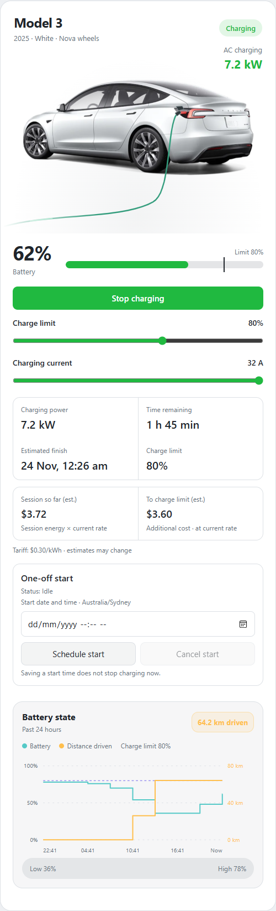
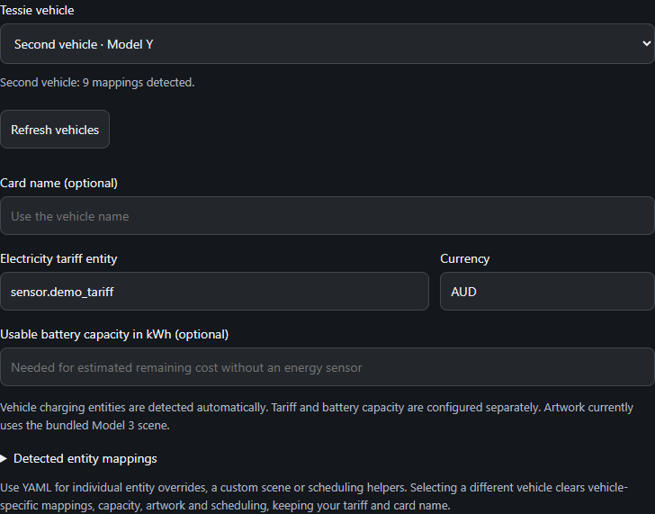

# Tessie Card

[](https://github.com/Phill360/Tessie-Card/releases/latest)

A custom Home Assistant charging card for the
[Tessie integration](https://www.home-assistant.io/integrations/tessie/).
Inspired by the rendered scenes and flow presentation in
[Sigenergy Flow Card](https://github.com/jyavenard/sigenergy-flow-card).



## Included

- Local Tesla renders for Model 3 (2018–2020, 2021–2023 and Highland) and Model Y
  (original and Juniper), Model S (2012 onward), Model X (2015 onward) and Cybertruck,
  with model, generation, trim, paint, interior and wheel
  selectors in the visual editor. The default is a white Model 3 Highland.
- A cable enters from outside the scene with no charger visible. Rear views show
  charging animation; front-view fallbacks are labelled and hide the cable.
- Battery percentage, target marker, charging power, remaining time and finish time.
- A rolling 24-hour battery graph with an amber distance-driven overlay,
  kilometre axis and total distance badge from odometer history.
- Session cost and estimated additional cost to reach the limit, using a tariff entity.
- Always-visible start/stop, charge-limit and charging-current controls.
- One-off start date/time through an optional persistent Home Assistant package.
- Settings to show or hide the battery graph and schedule control.
- Home Assistant theme colours, responsive layout, reduced-motion support,
  unavailable states, command-pending feedback and errors.
- A visual vehicle picker with automatic Tessie entity discovery.
- No JavaScript dependencies, compilation, external fonts, or direct Tessie API token.

This build has automated local tests and a simulated browser demo. It has **not
yet been validated against a live Home Assistant/Tessie installation**. Entity IDs
can be detected from the selected vehicle or mapped manually. The prepared
Model 3, Model Y, Model S, Model X and Cybertruck artwork is bundled. Choose the appearance in the visual
editor; paint and wheels are not inferred from vehicle telemetry.
Use `vehicle_image` for another complete scene.

Historical S/X appearance groups offer verified Black interior artwork, five
paint colours and the available wheel options. Earlier Model S uses a front
view with the cable hidden; earlier Model X includes a rear charging view.

## Install with HACS (recommended)

Install [HACS](https://www.hacs.xyz/docs/use/) first. Tessie Card is available as a
custom repository; it has not been admitted to the default HACS catalogue.

1. Open HACS, select the three-dot menu, then **Custom repositories**.
2. Enter `https://github.com/Phill360/Tessie-Card`, choose **Dashboard**, and add it.
3. Find **Tessie Card**, open it and select **Download**.
4. Reload the browser when prompted. HACS normally registers the resource for you.
5. Add **Tessie Card** from the dashboard card picker. In the visual editor, select
   your Tessie vehicle and your electricity tariff sensor.

The vehicle scenes are embedded in the download. No image folders need copying.
Updates are managed through HACS. For YAML-mode dashboards, register this resource
manually as a JavaScript module:

```yaml
url: /hacsfiles/Tessie-Card/tessie-card.js
type: module
```

The capitalisation of `Tessie-Card` in the resource URL matches the repository.
The optional one-off scheduling package still needs separate installation; HACS
installs the dashboard card, not Home Assistant automations or helpers.

### Switching from the original manual installation

Remove the old `/local/tessie-card/tessie-card.js` dashboard resource before
installing through HACS, then reload. Keep only one registered copy of the card.
Your card configuration and entity mappings can stay the same.

## Install manually

1. Download `tessie-card.js` from the latest GitHub release (or the repository
   root) and copy it to `/config/www/tessie-card/tessie-card.js`.
2. Add a dashboard resource (Settings > Dashboards > Resources):
   URL `/local/tessie-card/tessie-card.js?v=VERSION`, type **JavaScript module**.
   Replace `VERSION` with the version you downloaded to refresh the browser cache.
3. Add a manual card using [examples/card.yaml](examples/card.yaml), replacing
   every example entity ID with the real ID from Developer Tools > States.
4. Reload the dashboard. Increase the resource version query after updating files.

The root `tessie-card.js` is a generated standalone file. The `assets` folder is
needed only for development, not for installation.

## Vehicle appearance

In the card editor, use **Tessie vehicle** to choose the physical car and
**Vehicle appearance** to choose its render. The artwork selectors cover vehicle
model, generation, vehicle variant, paint colour, trim colour and wheels.
Each dropdown offers only available downloaded combinations; changing a parent
preserves compatible choices and resets incompatible ones. The editor shows a
live image preview. Changing the physical Tessie vehicle clears its appearance
settings, along with other vehicle-specific settings.

**Vehicle variant** selects RWD, Long Range/AWD or Performance as available.
**Trim colour** contains Black or White, without duplicate interior-code entries.
The original Model Y RWD uses the matching Long Range artwork, retaining the same
vehicle size and cable alignment.

The 2018–2020 Model 3 rear-view code returned a taillight close-up, so this group
uses full-car front views. Three newer Model 3 combinations also use front views
where rear requests failed. These views are labelled and have no cable overlay.
The remaining configurations use rear renders with the charging animation.

Advanced YAML can specify the same selection:

```yaml
artwork:
  model: my
  generation: legacy2020
  trim: MTY09
  paint: PPSW
  interior: INPB0
  wheel: WY20P
```

This example selects an original Model Y Long Range AWD with white paint, black
interior and 20-inch Induction wheels. `vehicle_image`, when set, overrides the
selected render and hides the built-in cable. Choose an appearance option in the
editor to return to the bundled renders.

## Automatic vehicle setup



The visual editor lists vehicle devices belonging to the Tessie integration and
maps battery, charge switch, limit, current, power, connection, completion estimate,
charging status, session energy and location where supported. It uses device IDs
and integration metadata rather than guessing entity names, so renamed/localised
entities work. Energy products and entities from other integrations are excluded.

With one detected vehicle, this minimal card automatically selects it:

```yaml
type: custom:tessie-card
entities:
  tariff: sensor.electricity_rate
currency: AUD
```

With multiple vehicles, select one in the editor. The saved `device_id` pins the
card to that vehicle. It never silently switches to another car if the selected
device disappears. A vehicle can also be pinned in YAML:

```yaml
type: custom:tessie-card
device_id: your_home_assistant_device_id
entities:
  tariff: sensor.electricity_rate
```

Only registry reads are performed; the card does not enable disabled entities or
modify the integration. Ambiguous mappings are left unset. The editor displays
detected, disabled and missing entities. Tessie's disabled-by-default charging
binary sensor can be replaced automatically by its charging-state sensor.

Registry events refresh mappings after a rename or removal; **Refresh detection**
and **Refresh vehicles** provide manual retry. If registry access is unavailable,
explicit mappings still work. Existing fully manual configurations remain manual.
For a selected device, individual `entities:` values override detected mappings.

Electricity tariffs, usable battery capacity, custom cost sensors and one-off
scheduling helpers are separate from the vehicle and must still be configured.
The editor exposes tariff, currency, optional battery capacity and card name;
advanced overrides and scheduling remain in YAML. Selecting another vehicle clears
vehicle-specific entity overrides, capacity, custom artwork and scheduling to
avoid carrying settings or commands over from a different car. Tariff and card
name are retained. The default vehicle artwork remains the bundled Model 3 scene.

## Entity mappings

Optional overrides go under `entities:`. A manual configuration without a selected
device needs all four core mappings; the card disables missing controls rather
than guessing. IDs are not derived from the vehicle name.

| Key | Domain | Purpose |
| --- | --- | --- |
| `battery` | sensor | Required; battery percentage |
| `odometer` | sensor | Optional distance overlay; cumulative odometer in km, mi or m |
| `charge` | switch | Required; charging enable/disable switch |
| `charge_limit` | number | Required; charge-limit control, using entity min/max/step |
| `charge_current` | number | Required; current control, using entity min/max/step |
| `charging` | binary_sensor | Actual charging status; recommended |
| `charging_status` | sensor | Tessie charging-state enum; fallback when the binary sensor is disabled |
| `plugged_in` | binary_sensor | Cable connection; recommended |
| `power` | sensor | Charging power, W/kW/MW |
| `completion` | sensor | ISO timestamp of expected completion; preferred Tessie source |
| `time_remaining` | sensor | Alternative duration in s/min/h |
| `tariff` | sensor | Current electricity rate |
| `session_energy` | sensor | Energy added this session, Wh/kWh/MWh |
| `session_cost` | sensor | Optional persistent session-cost total in the configured currency |
| `remaining_energy` | sensor | Optional required **wall energy** to the limit, Wh/kWh/MWh |
| `location` | device_tracker | Optional header location |

The charge switch being on does not establish actual energy delivery; animation
and completion estimates use the charging binary sensor or Tessie charging-state
sensor fallback. Completion estimates
are hidden when charging is not confirmed. Missing readings show a dash, not zero.
Unknown controls are disabled. Sliders send a command on release, then wait for an
entity update. A 20-second timeout means no confirmation, not proof of failure.

## Cost configuration

Set `currency: AUD` (or another three-letter currency). Tariff units supported:
`AUD/kWh` for that currency, `c/kWh`, `¢/kWh`, or `AUDc/kWh`. Generic cents units
are interpreted as cents of the configured currency. Unsupported/missing units
are not guessed. Negative tariffs are supported.

**Session so far:** a configured `session_cost` entity in the matching currency
takes priority. Otherwise, session energy × current tariff is explicitly labelled
an estimate. This is not an accumulated variable-tariff bill: a tariff change can
reprice the whole estimate. Tessie session energy may represent energy added to
the battery rather than billed wall energy; check your source. For accurate cost,
supply a persistent server-side cost sensor that accounts for rate changes, wall
energy, and session boundaries. No browser-only cost accumulator is used.

**To charge limit:** additional cost from now, at the current tariff. Prefer a
`remaining_energy` sensor. Alternatively set your vehicle's verified usable
`battery_capacity_kwh` and `charging_efficiency` (default `0.9`). The estimate is
`max(0, limit − battery) / 100 × capacity / efficiency × tariff`. Capacity is never
assumed from the Model 3 name. This estimate does not forecast future tariff
changes. Missing input leaves the estimate unavailable.

## One-off scheduling

Install [examples/tessie_charging_package.yaml](examples/tessie_charging_package.yaml)
as an optional Home Assistant package. **Replace both occurrences of
`switch.my_tesla_charge`** with the same switch mapped to the card. Enable packages
in `configuration.yaml` if needed:

```yaml
homeassistant:
  packages: !include_dir_named packages
```

Merge this into an existing `homeassistant:` section; do not create a duplicate.
Put the package in `/config/packages/`, check the Home Assistant configuration,
then restart. Do not run automations manually as a validation step.

Add this to the card configuration:

```yaml
schedule:
  control_script: script.tessie_schedule_control
  datetime_entity: input_datetime.tessie_charge_start
  armed_entity: input_boolean.tessie_charge_start_armed
  status_entity: input_select.tessie_charge_schedule_status
```

The card accepts a date/time in Home Assistant's configured timezone, independent
of the browser timezone. Past times and ambiguous/nonexistent daylight-saving
times are rejected. The schedule persists in Home Assistant and runs with the
dashboard closed. Saving does not stop an already charging vehicle.

The package serializes saves, cancellations and execution. It consumes each start
before requesting charging, waits up to 45 seconds for charge-switch acknowledgement,
and reports Started or Failed. Started means the charge switch acknowledged the
request; active charging is still determined by the charging sensors. A missed start
is marked Missed rather than replayed on startup. Recovery runs each minute.
Execution within 60 seconds of the intended time is allowed; no implicit retries.
Cancellation cannot undo a start already sent to the vehicle. Each additional
vehicle needs its own separately named package and helpers.

The example package has not been exercised on a live Home Assistant installation;
run Home Assistant's configuration check before enabling it. Scheduling remains
visible but disabled if the package is absent.

## Local development

Requires Node.js 20 or later. No dependency installation step:

```sh
node scripts/build.mjs
node scripts/serve.mjs
node --test
```

Open `http://127.0.0.1:8124/` for the interactive demo. It simulates charging,
connected idle, charge-limit reached, disconnected, unavailable and command errors.
Controls never contact a real vehicle in the demo.

Optional browser checks use Playwright and a locally installed browser:

```sh
node scripts/browser-check.mjs /absolute/path/to/playwright/index.mjs msedge
```

The script starts its own test server on port 8125 and saves screenshots in
`test-results/`. Without arguments it uses an installed `playwright` package and
its default Chromium browser. CI runs unit tests, syntax and distribution checks.
HACS validation runs separately for the plugin category. Its license check is
excluded until the repository owner chooses an open-source license; this does not
imply default-catalogue approval.

Edit `src/tessie-card.js`, then run `node scripts/build.mjs` and commit the generated
root module. Both PNG scenes are embedded as data URLs so HACS installs one file.
`node scripts/build.mjs --check` checks reproducibility without writing files.
For a new version, update `package.json` and the source version, rebuild, then push
a matching `vX.Y.Z` tag. The release workflow tests the build and publishes the
standalone module as a GitHub release asset.

## Artwork and design

The bundled vehicle images are locally stored Tesla compositor renders. A separate
SVG cable and connector overlay follows the left-rear charge port, with a green
pulse moving towards the car only during confirmed charging. Connected idle
shows a static cable; disconnected or unknown connection states hide it (unless
charging is confirmed). Reduced-motion settings retain a static cable.
`vehicle_image` accepts a local absolute URL or an HTTP(S) URL for a complete
scene; custom scenes disable the built-in cable overlay. A custom scene is used
for all states. Prepared WebP renders are deduplicated and embedded in the card;
only the selected image is decoded for display. The larger original PNG archive
stays local. Artwork source details are recorded in [assets/README.md](assets/README.md).

The battery state chart shows a rolling 24 hours of the mapped battery sensor's
recorded percentage, with a teal line, current charge limit, and daily low/high.
An amber overlay and right-hand kilometre axis show distance driven, calculated
from the same vehicle's odometer history, with a total distance badge. The Tessie
odometer is detected automatically; manual mappings use `entities.odometer`.
Miles and metres are converted to kilometres. Recorder must include the odometer
as well as the battery sensor. Incomplete history is labelled as recorded distance;
an odometer reset leaves the distance unavailable rather than inventing a total.
The visual editor has **Show battery graph** and **Show schedule control** toggles.
Both default to shown. YAML equivalents are `show_battery_graph: false` and
`show_schedule: false`. Hiding the graph stops history requests; hiding the
schedule control does not cancel a start already saved in Home Assistant.
Times use Home Assistant's configured timezone. History refreshes every five
minutes while the card is connected. Home Assistant's history and recorder must
be enabled and include the battery entity; missing history and unavailable states
are displayed as empty data or gaps. No additional chart card is needed.

The [design brief](docs/design-brief.md) records the agreed scope. Climate controls,
recurring schedules, charging session history and multi-vehicle switching are outside
version one. Next validation is mapping real entities and checking behaviour on
the user's Home Assistant installation.
